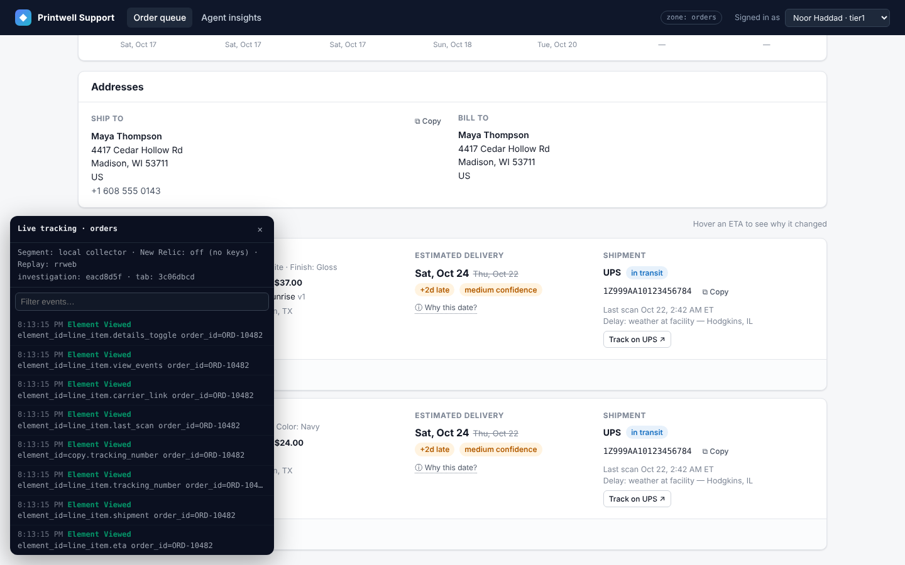
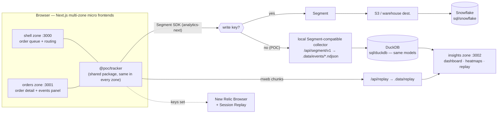
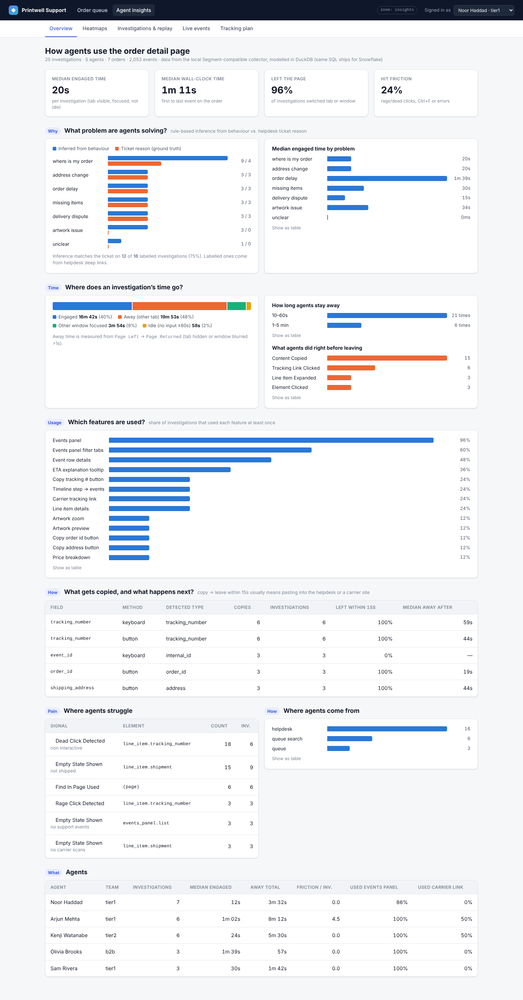
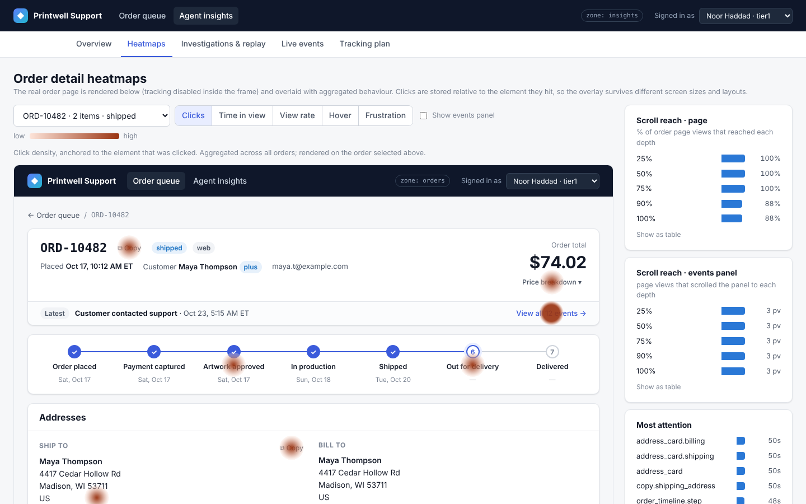
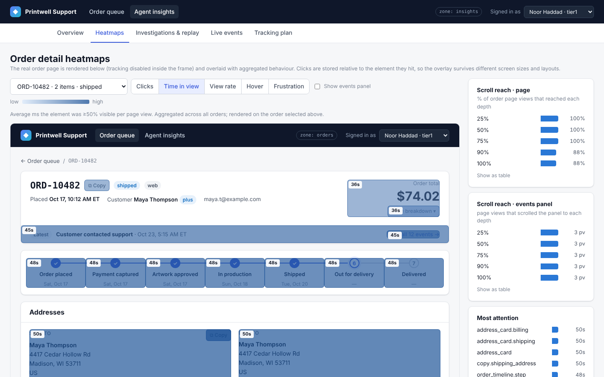
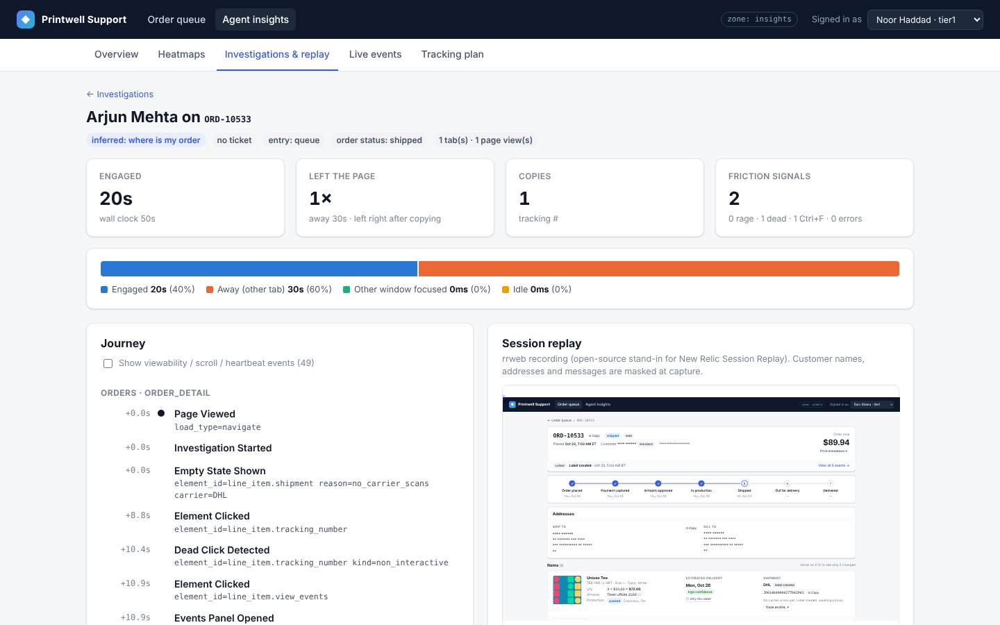

# Agent behaviour analytics — POC

A dummy support console (order queue → **order detail page** → **order events panel**) instrumented to answer
how human support agents actually use it:

| Question | Answered by |
|---|---|
| **What** is the agent doing? | clicks, feature events, viewability of every element, the step-by-step journey |
| **How** are they doing it? | entry point, paths, copy/paste, tab switching, keyboard vs button, session replay |
| **Why** — what problem are they solving? | helpdesk ticket reason (ground truth) + behaviour-based inference, scored against each other |
| **How much time** does it take? | engaged vs. away vs. other-window vs. idle time per investigation |
| **What problems** do they hit? | rage clicks, dead clicks, Ctrl+F, empty states, errors, copy → leave to another tool |
| **How are features used?** | adoption % per feature, time-to-first-use, per agent and team |

It runs **fully locally with no keys**, using the same code paths that go to **Segment → Snowflake** and
**New Relic** once keys exist.



## Quick start

```bash
pnpm install
pnpm dev          # shell :3000 (entry point) · orders :3001 · insights :3002
```

1. Open **http://localhost:3000** (always go through the shell; it routes the other zones).
2. Open an order or one of the simulated helpdesk tickets, click around, scroll, copy a tracking number, switch tabs.
   The **● Tracking** pill (bottom left) shows every event as it's sent.
3. Generate realistic data from simulated agents (headless Chromium):

   ```bash
   pnpm simulate                 # 24 investigations, 4 at a time (~2 min)
   pnpm simulate --runs 40 --concurrency 6
   pnpm simulate --persona wismo_struggling --headed
   ```
4. Open **http://localhost:3000/insights**.

Requirements: Node ≥ 20.9 (tested on 22), pnpm 10. The simulator needs Chromium for Playwright 1.63
(`pnpm --filter @poc/agent-sim exec playwright install chromium` if you don't have it).
`pnpm reset-data` wipes collected events.

## Architecture



| Path | What it is |
|---|---|
| `apps/shell` | Entry zone. Order queue, simulated helpdesk tickets, **local collector** (`/api/segment/v1/*`, `/api/replay`), rewrites `/orders/*` and `/insights/*` to the other zones. |
| `apps/orders` | The order detail micro frontend (`basePath: /orders`): header + total, order timeline, addresses, line items with artwork/ETA/tracking, events panel with filter tabs, artwork preview. |
| `apps/insights` | Analytics micro frontend (`basePath: /insights`): overview, heatmaps, investigations + session replay, live event feed, tracking plan. Not itself tracked. |
| `packages/tracker` | The tracking SDK: core, plugins, destinations (Segment / New Relic / local), React bindings and the live inspector. |
| `packages/warehouse` | SQL models (DuckDB for local, Snowflake port), query layer used by the dashboard, `pnpm models` CLI. |
| `packages/agent-sim` | Playwright-driven simulated agents (8 personas). |
| `packages/mock-data` | Orders, events, generated SVG artwork, agents. |
| `packages/ui` | Shared header, agent picker and design tokens (every zone looks like one app). |
| `docs/tracking-plan.md` | Generated tracking plan (every event, why it exists, its properties). |

**Micro frontends**: each zone is an independent Next.js 16 app (Next.js multi-zones). The shell routes by path,
zones hard-navigate between each other, and they share code through workspace packages. The tracker keeps
`session_id`, `tab_id` and `investigation_id` in browser storage, so a journey that crosses zones stays one journey.

## What gets tracked, and how

Most tracking is automatic. Product code only adds `data-track-*` attributes, plus a few explicit feature events
(see [docs/tracking-plan.md](docs/tracking-plan.md)).

| Concern | How it's captured | Events |
|---|---|---|
| **Viewability** | `IntersectionObserver` on every `[data-track-id]` element (including ones that mount later, like the events panel). "Viewed" = ≥50% visible (or filling half the viewport) for ≥1s continuously, the IAB rule. Time in view accrues only while the tab is visible, and is batched per element. | `Element Viewed`, `Element Exposure Recorded` |
| **Hover / attention** | Hover time per element (and its ancestors); hover-intent events on elements that explain things (e.g. *Why this ETA?*). | `Element Hovered`, exposure `hover_ms` |
| **Scrolling** | Page and scroll-container (events panel) depth milestones 25/50/75/90/100, including what the first screen already shows. Also max depth, direction reversals (hunting) and distance. | `Scroll Depth Reached`, `Engagement Time Recorded` |
| **Heatmaps** | Every click is stored **relative to the element it hit** (`element_id` + `x_rel/y_rel`), not page pixels, so heatmaps survive different screens and layout changes. The dashboard renders the real page in an iframe and overlays click density, time in view, view rate, hover and frustration per element, plus scroll reach. | `Element Clicked` |
| **Leaving and coming back** | Tab hidden (`visibilitychange`) vs. another window focused (`blur`, debounced 1s), with `away_ms` on return. Each leave records the last action before it, so **copy → leave → return** shows up (the agent pasted into the helpdesk or a carrier site). | `Page Left`, `Page Returned` |
| **What's copied** | Copy/cut via keyboard, context menu or a copy button; paste into inputs; text selection without copying. **The text never leaves the browser**: the event holds the semantic field (`tracking_number`, `shipping_address`…), a detected type, the length and a non-reversible hash. Anything inside `[data-pii]` is only ever labelled `pii`. | `Content Copied`, `Content Pasted`, `Text Selected` |
| **Time** | Engaged (visible + focused + input within 60s), idle, away and other-window time, sent as heartbeats and on every hide or page exit. | `Engagement Time Recorded`, `Agent Idle/Active` |
| **Friction** | Rage clicks (3+ in 800ms within 32px), dead clicks (no DOM change, navigation or selection within 700ms; drags and double-clicks excluded), Ctrl/Cmd+F, JS errors, empty states. | `Rage/Dead Click Detected`, `Find In Page Used`, `Error Encountered`, `Empty State Shown` |
| **Where they came from / why** | `entry_point` (helpdesk deep link, queue, queue search, direct, external…). Helpdesk links carry `?ticket=&reason=`, the ground truth for "what problem is the agent solving". | `Investigation Started` |
| **Session replay** | rrweb (open source) as the stand-in for New Relic Session Replay. Inputs and every `[data-pii]` node are **masked at capture**. | `/api/replay` |

The tracking number on the order page is deliberately plain text, not a link, so the POC shows the dead and rage
clicks you get when agents expect a link.

### The unit of analysis: an *investigation*

One agent can work 30 orders in one browser session, so sessions are the wrong unit. An **investigation** is
**one agent × one order × one 30-minute activity window**, and is shared across tabs and zones. Every event carries
`investigation_id`, and `packages/warehouse/sql/*/03_investigations` rolls it up:
- time: engaged, away, idle, wall-clock
- copies and leaves
- friction
- which features were used
- **inferred problem** vs. **ticket problem**

The inference is rule-based on purpose (artwork preview → artwork issue, copying the tracking number → where is my
order, …), so it can be scored against ticket ground truth. On the simulated data it matches the ticket on roughly 75–80% of
labelled investigations. The misses are mostly deliberate (a customer who says "delay" when the real problem is the
artwork) or investigations with too little behaviour to infer from.

## The dashboard (`/insights`)

| | |
|---|---|
|  |  |
|  |  |

- **Overview**:
  - problem mix (inferred vs. ticket) and inference accuracy
  - where time goes
  - how long agents stay away, and what they did just before leaving
  - feature adoption
  - copy → leave table
  - friction
  - entry points
  - per-agent table
- **Heatmaps**: clicks, time in view, view rate, hover, frustration, scroll reach (page and events panel), element table.
- **Investigations & replay**: every investigation with an inferred-vs-ticket check, then the full journey and its rrweb replay.
- **Live events**: what the collector receives, every 2s.
- **Tracking plan**: every event, the question it answers, and how many arrived.

## Going to production: Segment, Snowflake, New Relic

All configuration is env vars; see [`.env.example`](.env.example).

**Segment.** The tracker always uses Segment's own browser SDK (`@segment/analytics-next`).
- **With** `NEXT_PUBLIC_SEGMENT_WRITE_KEY` set: it behaves exactly as normal.
- **Without** a key: settings are inlined (`cdnSettings`) and the Segment.io destination's `apiHost` points at the
  shell's Segment-compatible endpoint, so the local collector receives byte-for-byte Segment payloads. That includes
  retries with the same `messageId`, which the staging model deduplicates.

`NEXT_PUBLIC_SEGMENT_MIRROR_LOCAL=true` keeps the local dashboard fed while also sending to Segment. Event names follow
Segment's *Object Action* convention, so `tracking-plan.ts` maps 1:1 onto a **Segment Protocols** tracking plan.

**Snowflake.** `packages/warehouse/sql/snowflake` holds the same models as the DuckDB ones, with the same names and columns.
- `00_setup.sql` lands raw payloads as `VARIANT` (Segment → S3 destination → Snowpipe). This is recommended because new
  properties never break the load, and it matches what the local collector writes.
- If you use Segment's native Snowflake destination instead, the notes at the bottom of `01_models.sql` show how to
  point `STG_EVENTS` at its tables.
- `pnpm models --export` writes every model to `.data/marts/*.parquet` if you'd rather load the POC's results directly.
- In a real setup, each model becomes a dbt model.

**New Relic.** Set the `NEXT_PUBLIC_NEW_RELIC_*` keys to load the Browser agent with Session Replay (same masking
selectors). Every tracker event is also sent as a PageAction. The join keys (`session_id`, `investigation_id`,
`order_id`, `replay_id`, …) are set as custom attributes, so a Snowflake row can be looked up in New Relic and back.

> **Not verified against live accounts:** the Snowflake SQL and the New Relic destination were written for this POC
> without credentials. The DuckDB models, the Segment SDK path (pointed at the local collector) and rrweb replay are
> exercised by the dashboard, the simulator and the tests.

## Privacy

- Replay masks every input and every `[data-pii]` node (customer names, emails, addresses, customer messages) **in the browser**.
- Copied, pasted and selected text is never sent: only field, detected type, length and a hash.
- Order search sends only the shape of the query (`query_type`, length), never the query itself.
- Agents are employees. Tracking their behaviour usually needs to be disclosed, and may need sign-off from
  HR/legal or a works council depending on the country. Treat this as product analytics, not performance management.

## Open-source building blocks

This POC uses **rrweb** (replay), **DuckDB** (local warehouse) and **Playwright** (simulated agents). If you'd rather
not depend on SaaS:
- **PostHog** (self-hostable): product analytics, autocapture, session replay, heatmaps, rage-click detection, and
  export to Snowflake. It's the closest single-tool replacement for New Relic replay plus much of Segment.
- **OpenReplay**: self-hosted replay with network, console and error data attached. Good for "what went wrong".
- **RudderStack / Jitsu**: open-source, warehouse-first Segment alternatives. The tracker's destinations are pluggable.
- **Snowplow**: schema-enforced event pipeline. Strongest data quality, more setup.
- **dbt** for the Snowflake models; **Metabase / Superset / Lightdash** for BI on top.

## Scripts

| Command | |
|---|---|
| `pnpm dev` / `pnpm build` / `pnpm start` | All three zones via Turborepo |
| `pnpm simulate [--runs N] [--concurrency N] [--persona name] [--headed]` | Simulated agents against `http://localhost:3000` |
| `pnpm models [--export]` | Build the models over `.data/events` and print a summary (optionally export Parquet) |
| `pnpm test` | Tracker unit tests (jsdom) + warehouse model tests (DuckDB on fixture events) |
| `pnpm typecheck` | TypeScript across all packages and apps |
| `pnpm --filter @poc/tracker plan:md` | Regenerate `docs/tracking-plan.md` |
| `pnpm --filter @poc/agent-sim screenshots` | Regenerate `docs/screenshots` |

## Limitations and next steps

- **Simulated tab switches.** Headless Chromium never hides a page, so the simulator emulates
  `visibilitychange`/`blur`. It also uses Playwright's fake clock, so a 3-minute investigation takes seconds.
  Real browsers emit these events natively.
- **Local collector is POC-grade.** It appends NDJSON files in a single process; DuckDB rebuilds the models in memory
  when new data lands.
- **Inference is rules.** Next step: once enough ticket-labelled investigations exist, train a classifier on the
  investigation features, e.g. Snowflake Cortex over the event sequence.
- **No sampling yet.** For production volumes, add sampling for replay and per-element exposure; keep feature
  events at 100%.
- **No dark theme.**
- **Suggested next experiments:**
  - Make the tracking number a link (watch dead clicks drop).
  - Pin the latest carrier scan above the fold (does copy → leave to the carrier site drop?).
  - A/B the events-panel filters, which agents currently toggle through when hunting.
